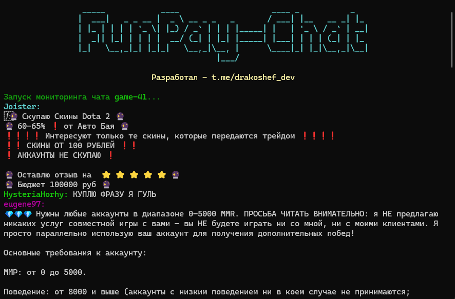

<div align="center">
<h1>FunPay Chat Monitor</h1>



<p><strong>Мониторинг чата FunPay через неофициальный API.</strong></p>


<br>
</div>

## Возможности

- Асинхронный опрос чата FunPay через `curl_cffi.AsyncSession`.
- Автоматическое получение `csrf_token` со страницы чата.
- У каждого пользователя свой цвет.
- Отслеживание новых сообщений по `last_message` и динамическому `tag`.

## Установка

### Клонирование репозитория

```bash
git clone https://github.com/TemaDrakoshef/funpay-chat-monitor.git
cd funpay-chat-monitor
```

### Через обычный Python

Требуется Python 3.12 или новее.

```bash
python -m venv .venv
```

Активируйте виртуальное окружение:

- Windows (PowerShell): `.venv\Scripts\Activate.ps1`
- Linux / macOS: `source .venv/bin/activate`

Установите зависимости:

```bash
pip install -r requirements.txt
```

### Через uv

```bash
uv sync
```

## Запуск

```bash
python main.py                               # чат game-41, интервал 2 c
python main.py --node game-1 --interval 1   # другой интервал и чат
```


```bash
uv run python main.py                               # чат game-41, интервал 2 c
uv run python main.py --node game-1 --interval 1   # другой интервал и чат
```

Список нод чата (примеры): `game-41`, `game-20`
`https://funpay.com/chat/?node=<node>`.

## Структура проекта

```
src/
├── config.py       # конфигурация (URL, задержки, User-Agent)
├── chat_client.py  # клиент API чата (csrf_token, POST /runner/)
├── parser.py       # парсинг HTML сообщений (автор, дата, текст)
├── formatting.py   # цвета пользователей и форматирование вывода
├── logger.py       # настройка логирования (rich)
├── main.py         # точка входа + асинхронный цикл мониторинга
└── __main__.py     # запуск через python -m src
```
